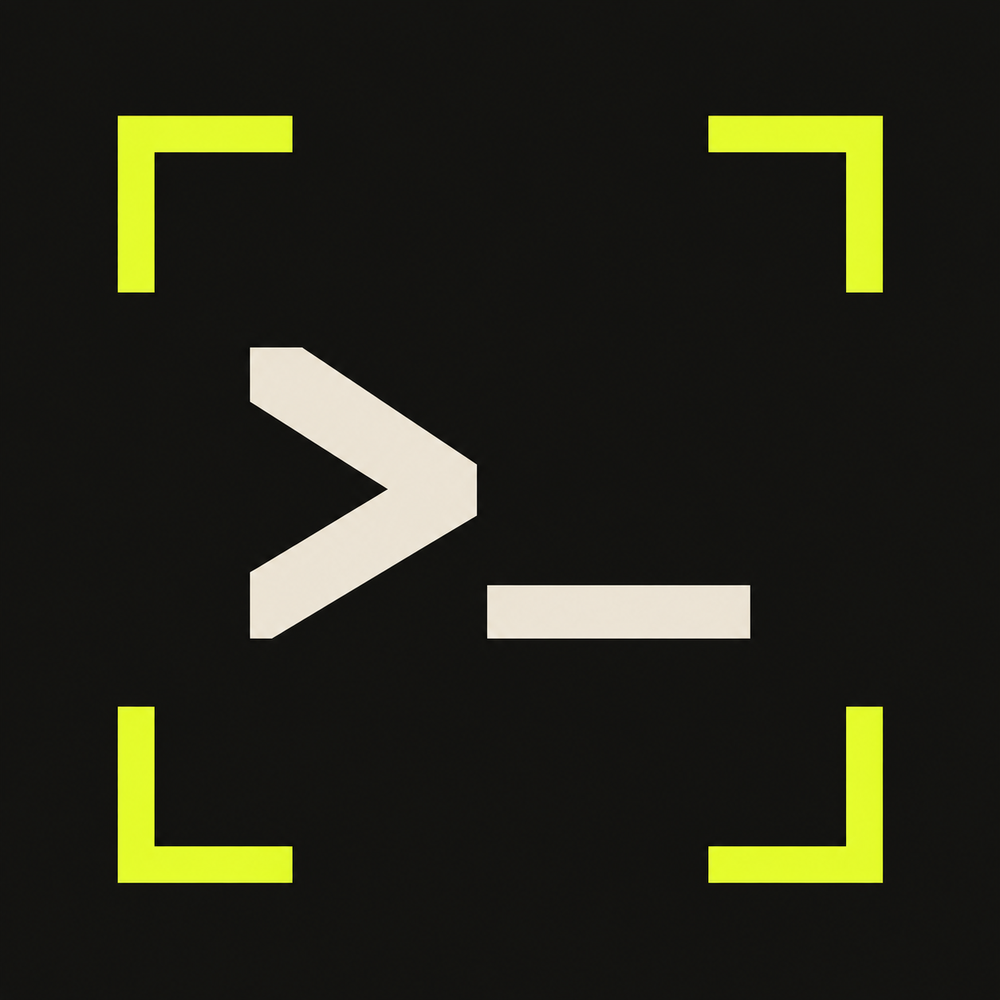

<p align="center">
  
</p>

# RemoteHub

A self-hosted, browser-based workspace for the computers you manage. Save a computer once, then open
it from any browser in tabs. Styled with the [Editorial Mono](design-system/editorial-mono/README.md) design system.

- **Terminal**: SSH sessions in tabs, with a fingerprint check on first connect; later connections are
  blocked if a server's identity changes.
- **Files**: browse, search, view, upload, rename, and delete over SFTP.
- **Desktop**: VNC and RDP in the browser through [guacd](deploy/guacd.md), including remote sound.
- **Agent** (optional): a small Rust service on a computer that adds live file events and desktop sound,
  and can be installed from RemoteHub with one click. See [`agent/README.md`](agent/README.md).
- **MCP** (optional): let AI clients such as Claude, ChatGPT, and Cursor use selected connected computers
  through OAuth. See [Remote MCP tools](#remote-mcp-tools).

**One owner account** protects the app. SSH passwords are typed when you connect and are never saved or
logged.

> **Security:** RemoteHub gives whoever signs in shell, file, and desktop access to every saved
> computer. Put it behind HTTPS (see [Behind a reverse proxy](#behind-a-reverse-proxy)), use a strong
> owner password, and read [SECURITY.md](SECURITY.md) before exposing it to the internet.

## Run it

```sh
npm install
cp .env.example .env   # optional; defaults match without a file
npm start
```

### Run the full stack with Docker Compose

On the computer hosting RemoteHub, install Docker Engine with the Compose plugin, then run
`docker compose up --build -d --wait` from the repository root. Open <http://127.0.0.1:8090> and
retrieve the first-run owner setup code with `docker compose logs remotehub`. Compose starts
the server and a pinned guacd build; guacd is reachable only on the private Compose network
and has no published host port. The `remotehub-data` volume preserves the owner account,
hosts, and trusted SSH host keys. Docker is not required on target computers. See
[`deploy/README.md`](deploy/README.md#one-command-docker-compose-deployment-hosting-computer)
for configuration, health checks, persistence, and the follow-on milestone sequence.

Open `http://localhost:8090`. On first run the server prints a **setup code** in its console (also saved to
`data/SETUP-CODE.txt`). Enter it with a new owner password to create the account.

Forgot the owner password? `npm run reset-owner` clears it (saved hosts are kept); restart and set it up again.

Settings are environment variables — see [.env.example](.env.example).

**Desktop (VNC/RDP)** needs [guacd](deploy/guacd.md). The Docker Compose deployment starts
the tested guacd build automatically. For a direct `npm start` deployment, install and
configure guacd separately and set `GUACD_ENABLED=1`; without guacd, Terminal and Files still
work while Desktop stays unavailable with a plain explanation. Target computers do not need
Docker. One-command guacd installation for direct npm deployments remains tracked separately.

## Behind a reverse proxy

To put RemoteHub on a public hostname (e.g. `remotehub.example.com`), use the drop-in configs and
checklist in [`deploy/`](deploy/README.md).

Summary for the common case — **proxy on the same machine** as RemoteHub:

1. Point DNS at this machine; open **80**/**443** only (not **8090**).
2. Keep `.env` at `HOST=127.0.0.1`, `PORT=8090`, `TRUST_PROXY=loopback`.
3. Install one of the configs under `deploy/` and set your domain.

HTTPS terminates at the proxy, which must forward WebSocket upgrades for `/ws/terminal`,
`/ws/files`, and `/ws/agent`. RemoteHub pings each session every 25 seconds so proxy idle timeouts (nginx defaults
to 60s) don’t drop quiet sessions.

If the proxy is on **another machine**, set `HOST=0.0.0.0` and `TRUST_PROXY` to the proxy’s IP, and keep
port **8090** reachable only from that proxy. Details: [`deploy/README.md`](deploy/README.md).

## Remote MCP tools

RemoteHub can expose selected, currently connected hosts through an OAuth-protected MCP endpoint at
`https://<your-domain>/mcp`. The endpoint uses stateful Streamable HTTP sessions with JSON responses (GET returns 405; SSE is not offered) and the 2025 MCP initialize flow. It negotiates `2025-11-25`, `2025-06-18`, or `2025-03-26`; an unsupported requested version falls back to `2025-11-25`. It validates version headers and uses OAuth authorization code with PKCE (S256), dynamic client registration, exact redirect-URI checks, issuer identification, resource-bound bearer tokens, and short-lived access tokens. Refresh tokens are issued and rotated when the client requests `offline_access` and registers the refresh-token grant.

For a public deployment, set `MCP_PUBLIC_URL` to the public origin only (for example
`https://remotehub.example.com`) in `.env`. Set `MCP_ALLOWED_ORIGINS` to a comma-separated allowlist of exact browser origins that may call `/mcp`; a supplied but unlisted Origin is rejected. Server-to-server clients that omit Origin remain supported. In Docker Compose, the variable is passed through to the
server. Keep the MCP endpoint, OAuth endpoints, and `/.well-known` metadata routes reachable through
the same HTTPS reverse proxy. The OAuth authorization server and resource server use that same origin.
Do not expose the app over public plain HTTP. OAuth clients expire after 90 days; owners can remove clients or revoke individual grants at `/oauth/manage`. Clients can revoke their own access or refresh tokens at `/oauth/revoke` using the [RFC 7009](https://www.rfc-editor.org/rfc/rfc7009.html) form with their registered `client_id`; the server verifies the token belongs to that client.

After a client follows the OAuth flow, the owner chooses the connected hosts and scopes for that grant.
The tools are:

- `remotehub.hosts.list` — list selected hosts that are connected now (`hosts:read`).
- `remotehub.files.list` and `remotehub.files.read` — list or read text files under the agent root (`files:read`; reads are limited to 64 KiB). Directory listings return at most 256 entries per page (100 by default); pass `nextCursor` as `cursor` while `hasMore` is true.
- `remotehub.files.write` — write UTF-8 text under the agent root (`files:write`; content is limited to 1 MiB in UTF-8 bytes). `/mcp` JSON request bodies are capped at 8 MiB and server-to-agent WebSocket frames at 7 MiB to allow bounded JSON escaping and envelope overhead.
The `remotehub.commands.run` tool requires a separate `commands:exec` OAuth scope, an explicit host selection in the grant, a connected Windows agent advertising `exec.run`, and the server opt-in `MCP_COMMANDS_ENABLED=true` (default: false). It passes an executable and argv directly without shell-string parsing, accepts at most 64 arguments (4096 bytes each, 64 KiB combined), 64 KiB stdin, a 1–300 second timeout, and returns bounded stdout/stderr (truncated when needed). The agent currently advertises command execution only on Windows, where it uses a Job Object to terminate the job and waits for all job processes before collecting output. Unix agents do not advertise or run commands because detached descendants can retain output pipes and prevent bounded reader shutdown.

Commands run with the operating-system privileges and inherited environment of the RemoteHub agent service account. The configured agent filesystem root only sets the command's working directory; it does not restrict filesystem, network, or process access. An explicitly selected shell executable such as `sh -c`, `bash -c`, or `cmd.exe /c` remains powerful. This feature is host command authority, not a sandbox. Commands are available only on supported Windows agent builds; other operating systems fail closed. This remains host-level authority and must not be used as a sandbox for untrusted commands.

Windows Job Object cleanup cannot contain work deliberately launched through an external broker such as WMI: broker-launched processes are outside the agent's job. The agent account retains its full operating-system authority, so command execution is not a security boundary.

File operations require the selected host's persistent agent to be connected. Update and restart the agent to advertise `fs.list.page`, `fs.read`, and `fs.write`; older connected agents do not advertise safe paginated listing, so the MCP listing tool is withheld until they are updated. Access grants are bound to the selected host IDs and the MCP resource URI. They do not reuse the browser's session cookie or agent credential. MCP `tools/call` is limited to 30 calls per token and 300 per OAuth client
per minute; excess calls receive HTTP 429 with `Retry-After`. OAuth authorization password fallback
allows five failed attempts per source IP in a 15-minute window, followed by a ten-minute IP lockout.
It also allows five failed password attempts across all IPs in one process before a 60-second cooldown;
excess attempts receive HTTP 429 with `Retry-After`. That cooldown temporarily blocks password fallback
even when the submitted password is correct; a successful password clears the aggregate failure count.
Per-IP storage is capped at 10,000 entries and evicts the oldest bucket to admit a new IP. These password
throttles are process-local (not shared across workers), use bounded in-memory storage, and reset when
the server restarts. OAuth client registrations, grants, issued authorization-code records, and token records are stored in the local `mcp-oauth.json` file.
Pending consent requests, sessions, connected agent sockets, and rate-limit state are process-local.
Run one RemoteHub server process per data directory; processes do not coordinate access to that file or share in-memory state.
Tool-call limiter storage fails closed at capacity rather than evicting
active counters. File reads and writes use cap-std directory capabilities rooted at the
configured agent directory; paths cannot escape that root, including through symlinks.
Symlinks that resolve within the root remain permitted.

Grant revocation sends request-ID cancellation to an updated connected agent, which drops matching requests still in its queue. A file write that has already started is synchronous and cannot be interrupted; it may complete after revocation.

For ChatGPT, custom MCP servers and full MCP support are available on Business and Enterprise/Edu on the web. Use the public HTTPS `/mcp` endpoint or an OpenAI Secure MCP Tunnel for private deployments; allow the exact callback URI shown in its connection settings. Pro supports custom MCP servers with read/fetch permissions. Claude remote connectors are available on Free, Pro, Max, Ultra, Team, and Enterprise; Claude connects from Anthropic's cloud, so allow inbound access from Anthropic's published IP ranges. Cursor documents remote Streamable HTTP with OAuth; for Cursor-hosted Cloud Agents, HTTP MCP requests come from Cursor's backend and the endpoint must be reachable there. Every client uses its own redirect URI and registration identity.

RemoteHub follows the [MCP 2025 authorization specification](https://modelcontextprotocol.io/specification/2025-11-25/basic/authorization)
and [Streamable HTTP transport](https://modelcontextprotocol.io/specification/2025-11-25/basic/transports).
See the official [OpenAI client setup](https://help.openai.com/en/articles/12584461-connecting-custom-mcp-servers-in-chatgpt) and [OAuth guide](https://developers.openai.com/plugins/build/auth),
[Anthropic remote connector guide](https://support.claude.com/en/articles/11175166-get-started-with-custom-connectors-using-remote-mcp),
and [Cursor MCP guide](https://cursor.com/docs/mcp) and [Cloud Agent network notes](https://cursor.com/docs/cloud-agent/self-hosted/my-machines).

## Develop

```sh
npm run dev   # restarts on file changes
npm test      # unit tests + end-to-end tests against a fake SSH server
```

| Path | What |
| --- | --- |
| `server/app.js` | HTTP API, auth, static files, WebSocket upgrade |
| `server/ssh-bridge.js` | One WebSocket ⇄ one SSH shell, fingerprint check |
| `server/sftp-bridge.js` | One WebSocket ⇄ one SFTP session, directory listing and metadata primitives |
| `server/store.js` | `data/remotehub.json`: owner hash, hosts, known fingerprints |
| `server/capabilities.js` | Versioned host capability model (Terminal / Files / Desktop / Agent) |
| `public/` | Browser app (plain ES modules + xterm.js) |
| `deploy/` | Caddy / nginx reverse-proxy configs |
| `agent/` | Optional Rust agent/helper (persistent and temporary modes) |
| `design-system/editorial-mono/` | Tokens and rules for the UI |

## Testing locally

You need Node.js 22.9+ (`.nvmrc` pins 22) and git. Everything else is optional.

```sh
npm ci                # project dependencies
npm run doctor        # read-only: lists what's installed and what to add, changes nothing
npm test              # all tests (they write only to your OS temp dir)
npm run test:clean    # same, and fails if the tests changed any file in the repo
```

**Test harness: a private test world in one command.**

```sh
npm run harness up mine     # SSH test server, VNC desktop, guacd and RemoteHub on free ports
npm run harness status      # what's running and the URLs
npm run harness down mine   # stops only what "up mine" started and deletes its files
```

- `up` prints the RemoteHub URL. Logins and passwords are in the instance's state file (path printed by `up`)
  (only you can read it) and are never printed or logged.
- Several people can run it at once with different names (`up alice`, `up bob`): every port is
  picked by the operating system, and each instance keeps its files in its own uniquely named temp folder, which `down` deletes by exact path.
- The harness never uses sudo, never changes system settings or services, and never touches
  processes or ports it didn't start.
- The SSH test server is built in. Desktop tests (VNC and RDP) also need the remote desktop
  helper, guacd; see [`deploy/guacd.md`](deploy/guacd.md) for how to get it on your system
  (Docker, a package where one exists, or from source). VNC also needs `Xvfb`, `x11vnc` and
  `xterm`.
- RDP (Linux only) runs a private xrdp per instance without sudo, inside an unprivileged user
  namespace, with a harness-only login. It needs `xrdp`, `xorgxrdp`, `openssl`, a C compiler,
  guacd with RDP support, and a system that allows unprivileged user namespaces.
- Anything missing is skipped, never fatal: `npm run doctor` and `harness up` print one line per
  missing piece, with what to install on the line below it.
- Optional: to keep the harness off ports this computer reserves, create `.harness.local.json`
  (gitignored), e.g. `{ "blockedPorts": [3389, "5902-5914"] }`.

## License

[MIT](LICENSE)
